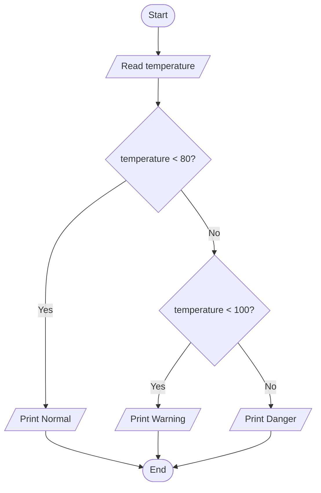

# CYB 207 assignment notes


## Q1. Decompose "Pipeline Leak Alert Systems" into 5 sub-problems
1. **Sensor monitoring** - collect pressure, flow in/out and temperature per pipeline section (simulated here).
2. **Data validation** - reject missing, non-numeric, negative or impossible values before using them.
3. **Leak detection** - compare the flow difference and pressure with thresholds and classify the status.
4. **Alert management** - create, show and acknowledge alerts according to severity.
5. **Monitoring and reporting** - dashboard, history of readings and alerts, JSON API.

## Q2. IPO tables
**This application (leak detection)**

| Input | Process | Output |
|---|---|---|
| pipeline section, pressure, flow in, flow out, temperature | validate data; calculate flow difference; compare with thresholds; classify status; create alert if needed | pipeline status, leak warning, severity, alert record, dashboard information |

**Assignment question: overtime salary calculator** (documentation only, not built)

| Input | Process | Output |
|---|---|---|
| basic hourly rate, normal hours worked, overtime hours, overtime multiplier | normal salary = rate x normal hours; overtime salary = rate x overtime multiplier x overtime hours; total = normal + overtime | total salary |

## Q3. Online work permit system requirements
Functional:
1. The system shall allow authorized users to submit a work permit application.
2. The system shall allow authorized personnel to review and approve or reject submitted work permits.

Non-functional:
1. The system should protect permit information through authentication and access control.
2. The system should respond to normal user requests within an acceptable response time.

(These belong to the assignment only; the work permit system is not implemented here.)


## Tank levels: read 10 tanks and print the average
Code: `examples/tank_average.py`. In the app: `app/tanks.py`, `GET /api/tanks`, dashboard "Tank levels".

```
SET total = 0
FOR n = 1 TO 10
    READ level of tank n
    total = total + level
END FOR
average = total / 10
PRINT average
```

## Temperature check: pseudocode and flowchart
Code: `examples/temperature_check.py`. In the app: `classify_temperature()` in `app/detection.py`
(WARNING raises the section status to at least WARNING, DANGER raises it to CRITICAL).

```
START
READ temperature
IF temperature < 80 THEN
    PRINT "Normal"
ELSE IF temperature < 100 THEN        // 80 to 99
    PRINT "Warning"
ELSE                                  // 100 or above
    PRINT "Danger"
END IF
END
```


